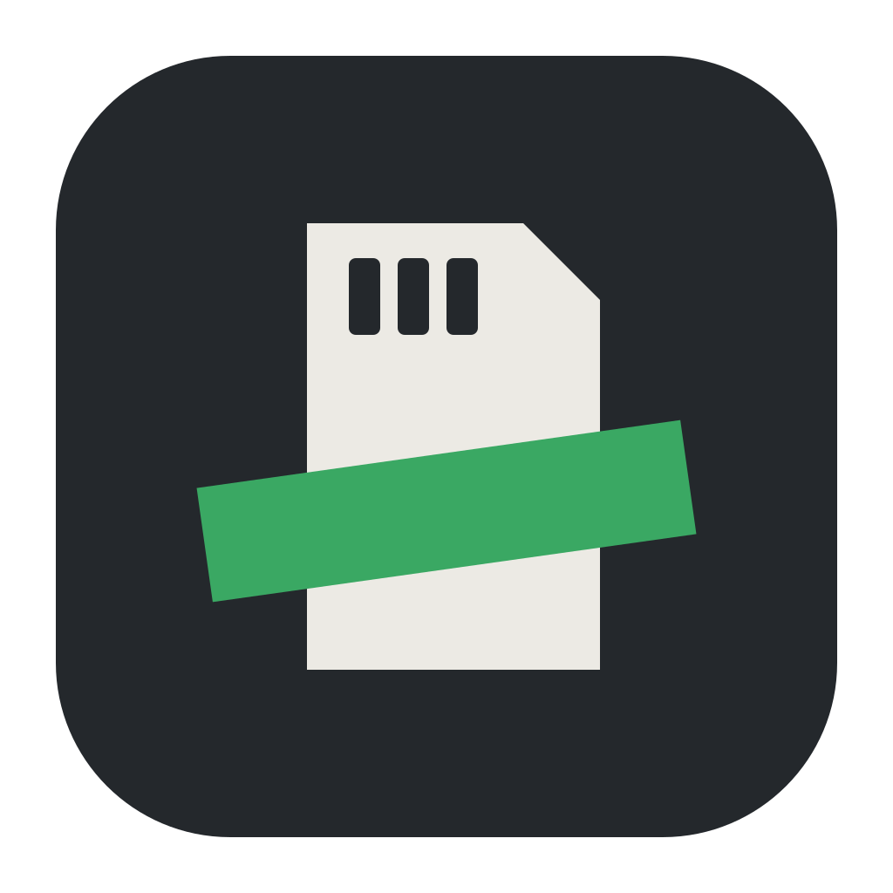
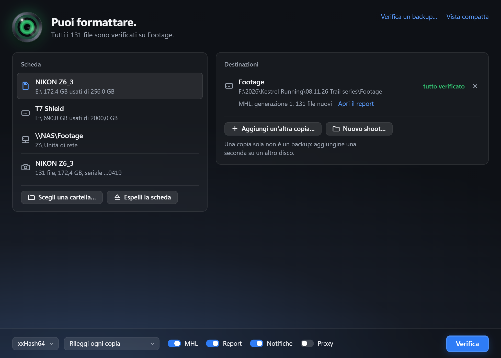
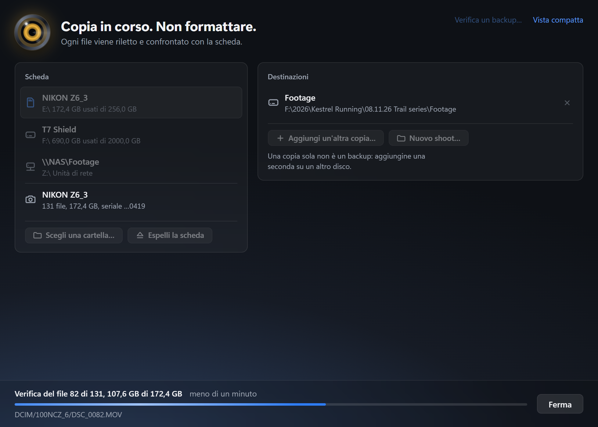
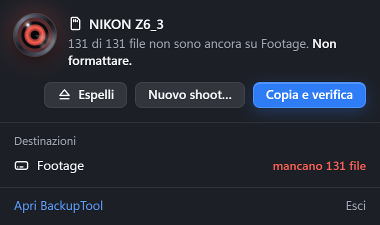

<p align="center">
  
</p>

<h1 align="center">BackupTool</h1>

<p align="center">
  Copia le schede delle camere su uno o più dischi e ti dice <b>“Puoi formattare”</b><br>
  solo quando ha dimostrato che ogni copia è identica all'originale.
</p>

<p align="center">
  Windows · macOS (Apple Silicon e Intel) · interfaccia in italiano
</p>

<p align="center">
  
</p>

## Indice

- [Cosa fa](#cosa-fa)
- [Installazione](#installazione)
- [Come si usa](#come-si-usa)
- [Come viene verificata una copia](#come-viene-verificata-una-copia)
- [Cartelle dello shoot](#cartelle-dello-shoot)
- [Proxy](#proxy)
- [MHL e report](#mhl-e-report)
- [Riga di comando](#riga-di-comando)
- [Sviluppo](#sviluppo)
- [Limiti noti](#limiti-noti)
- [Licenze](#licenze)

## Cosa fa

- **Copia verificata su più dischi insieme.** La scheda viene letta una volta sola e scritta su tutte le destinazioni; ogni copia viene poi riletta dal disco e confrontata con l'originale.
- **Non scrive mai sulla scheda.** La sorgente è sempre e solo letta.
- **Riconosce le schede.** Quando ne inserisci una l'app la propone da sola e mostra quanti clip, foto e file audio contiene, di che giorno sono e quale camera li ha scritti (quando la camera lo dichiara).
- **Sa cosa manca.** Prima di copiare dice quanti file della scheda non sono ancora sulla destinazione. I file già presenti vengono riletti e confrontati, non ricopiati; un file diverso con lo stesso nome non viene mai sovrascritto.
- **Crea le cartelle dello shoot**: cliente, data, nome, e dentro `Footage`, `Photo`, `Audio`, `Project`.
- **Proxy automatici** a fine copia, in una cartella `Proxy` accanto ai clip, dove DaVinci Resolve li trova da solo.
- **Storico ASC MHL** su ogni destinazione, per ricontrollare il backup anche dopo anni, e **report** HTML e CSV di ogni copia.
- **Vive nella tray.** Una finestrella accanto all'orologio basta per copiare, espellere la scheda e vedere a che punto è; una notifica avvisa quando ha finito.

## Installazione

Gli installer sono nella pagina delle [release](https://github.com/EdoardoBV/BackupTool/releases).

| Sistema | File | Note |
|---|---|---|
| Windows 10 e 11 (64 bit) | `BackupTool_<versione>_x64-setup.exe` | Si installa sopra la versione precedente. Non è firmato: al primo avvio Windows può chiedere conferma (“Ulteriori informazioni” → “Esegui comunque”). |
| macOS, Apple Silicon e Intel | `BackupTool_<versione>_universal.dmg` | Firmato con Developer ID e notarizzato da Apple: si apre con un doppio clic. |

FFmpeg, che serve per i proxy, è già dentro l'app: non c'è altro da installare.

## Come si usa

1. **Inserisci la scheda.** Compare a sinistra, con quello che contiene. Come sorgente vanno bene anche una cartella qualsiasi o, su Windows, un disco di rete collegato a una lettera.
2. **Scegli dove copiare.** “Aggiungi una destinazione…” per una cartella che esiste già, oppure “Nuovo shoot…” per far creare all'app le cartelle del lavoro. Una copia sola non è un backup: aggiungine una seconda su un altro disco.
3. **Premi “Copia e verifica”.** La barra in basso mostra file, gigabyte e tempo rimanente.
4. **Aspetta il verde.** La lente in alto a sinistra è rossa finché la scheda non è al sicuro (“Non formattare”), gialla durante la copia, e diventa verde quando ogni file è verificato su ogni destinazione (“Puoi formattare”). Solo allora espelli e formatta.

<p align="center">
  
</p>

In basso si scelgono il checksum (xxHash64 se non serve altro), quanto verificare, e se scrivere lo storico MHL, il report, le notifiche e i proxy.

Chiudendo la finestra l'app resta nella tray. La lente dell'icona ha lo stesso colore dello stato, e con un clic si apre la vista compatta:

<p align="center">
  
</p>

## Come viene verificata una copia

- Ogni file viene scritto con il nome provvisorio `.part`, **riletto dal disco** e confrontato con il checksum calcolato leggendo la scheda. Riceve il suo nome definitivo solo se coincide: un file con il nome giusto è sempre un file verificato.
- La rilettura salta la cache del sistema operativo. Altrimenti il confronto si farebbe con i dati ancora in memoria, non con quelli finiti davvero sul disco.
- Un file che fallisce non ferma la copia: viene segnato, e lo stato resta “Non formattare”.
- Fermando la copia, i file a metà vengono tolti; quelli già verificati restano e non verranno ricopiati.

Tre livelli di verifica:

| Scelta | Cosa fa |
|---|---|
| Rileggi ogni copia | Rilegge ogni copia e la confronta con la scheda. È la scelta normale. |
| Rileggi le copie e la scheda | Legge anche la scheda una seconda volta, per accorgersi di un lettore che legge male. |
| Nessuna verifica | Copia e basta. Non dimostra niente. |

Checksum disponibili: xxHash64, XXH3, XXH128, MD5, SHA-1, SHA-256, C4.

## Cartelle dello shoot

“Nuovo shoot…” chiede cliente e nome del lavoro, prende la data dalla scheda e crea su ogni destinazione:

```text
<destinazione>/<Cliente>/<data> <Nome dello shoot>/
    Footage/<Camera>/<Scheda>/...   i clip
    Photo/<Camera>/<Scheda>/...     le foto, solo se la scheda ne ha
    Audio/<Camera>/<Scheda>/...     l'audio, solo se la scheda ne ha
    Project/                        vuota, per il montaggio
```

I clienti non sono salvati da nessuna parte: sono le cartelle che ci sono già sul disco. Aggiungere una seconda scheda allo stesso shoot è la stessa operazione, e il livello `<Scheda>` serve quando due schede della stessa camera ripetono i nomi dei file.

## Proxy

Con l'interruttore “Proxy” acceso, finita e verificata la copia l'app crea i proxy dei video sulla prima destinazione.

- **Dove**: in una cartella `Proxy` accanto ai clip, con lo stesso nome. È la convenzione di DaVinci Resolve e di Blackmagic Proxy Generator.
- **Formato**: ProRes Proxy, ProRes LT, DNxHR LB, H.264 o H.265.
- **Dimensione**: HD (al massimo 1080 righe), metà, un quarto o quella originale.
- **Cosa resta uguale**: timecode, nome del clip e audio. Non viene applicato nessun look: il girato in log resta in log.
- **Clip da escludere**: si scelgono da “Formato e clip…”.

I proxy si fanno in coda, dopo la copia: la scheda è già al sicuro, si può espellere, e se ne può copiare un'altra mentre i proxy vanno avanti.

## MHL e report

**Storico ASC MHL.** Ogni copia verificata aggiunge una generazione alla cartella `ascmhl` della destinazione, nel formato [ASC MHL](https://github.com/ascmitc/mhl) v2.0: l'elenco dei file con i loro checksum, leggibile da qualsiasi programma che conosce lo standard.

**Verifica di un backup.** “Verifica un backup…” rilegge un backup già fatto, anche mesi dopo, e lo confronta con il suo storico: dice se un file è cambiato o manca. Il controllo si può registrare nello storico come nuova generazione.

**Report.** Ogni copia scrive nella cartella `Reports`, accanto al girato, una pagina HTML (che si stampa pulita, quindi diventa un PDF da qualsiasi browser) e un CSV per i fogli di calcolo.

## Riga di comando

Lo stesso motore dell'app è disponibile come comando `bt`.

```sh
cargo build --release -p backup-cli     # produce target/release/bt
```

```sh
bt card E:\                             # cosa c'è sulla scheda e quale camera l'ha scritta
bt compare E:\ F:\Backup                # quali file mancano sulla destinazione
bt copy E:\ F:\Backup G:\Backup --mhl   # copia su due dischi, verifica, scrive lo storico MHL
bt verify F:\Backup --record            # ricontrolla un backup e registra il risultato
bt proxy A001_C003.MOV --codec h264     # proxy di un clip, nella cartella Proxy accanto
bt hash A001_C003.MOV --algo sha256     # checksum di un file, letto dal disco
```

`bt <comando> --help` elenca le opzioni di ciascuno.

## Sviluppo

BackupTool è fatto con [Tauri 2](https://tauri.app): il motore è in Rust, l'interfaccia in React e TypeScript.

```text
crates/engine        il motore: scansione, copia, verifica, MHL, report, proxy. Nessuna dipendenza dall'interfaccia.
crates/cli           il comando bt
app/src              l'interfaccia (React)
app/src-tauri        l'app: finestre, tray, rilevamento delle schede, espulsione, notifiche
scripts              scarica FFmpeg; controlla gli MHL con lo strumento ufficiale ASC
.github/workflows    la build per macOS
```

### Cosa serve

- [Rust](https://rustup.rs) stabile
- [Node.js](https://nodejs.org) 22 o successivo
- Su Windows: gli strumenti di compilazione di Visual Studio (C++) e Git Bash, per lo script di FFmpeg

### Avviare l'app

```sh
bash scripts/fetch-ffmpeg.sh    # una volta sola: FFmpeg non è nel repository
cd app
npm install
npm run tauri dev
```

Per lavorare solo sull'interfaccia, senza schede né dischi, basta `npm run dev`: su <http://localhost:1420> la pagina gira con dati di esempio (`/?view=popover` per la finestrella della tray).

### Controlli

```sh
cargo test                      # dalla cartella principale
cargo clippy --all-targets
cd app && npx tsc --noEmit
```

I test dei proxy codificano davvero un clip se trovano FFmpeg, altrimenti vengono saltati; con `REQUIRE_FFMPEG=1` un test saltato diventa un errore.

### Installer per Windows

```sh
cd app
npm run tauri build
```

L'installer esce in `target/release/bundle/nsis/`.

### Build per macOS

Si fa su GitHub, con il workflow **Build for macOS**, che parte solo a mano (scheda Actions, oppure `gh workflow run build-macos.yml`). Produce un `.dmg` universale tra gli artifact della run.

- Con i cinque secret `APPLE_CERTIFICATE`, `APPLE_CERTIFICATE_PASSWORD`, `APPLE_ID`, `APPLE_PASSWORD` e `APPLE_TEAM_ID` l'app viene firmata con il Developer ID e inviata ad Apple per la notarizzazione. Senza, viene firmata ad hoc.
- La run aspetta la risposta di Apple per dieci minuti al massimo. Se Apple non ha ancora risposto finisce comunque bene, e il `.dmg` è quello che Apple sta esaminando: quando viene accettato, il workflow **Finish the macOS notarization** (un minuto, gli si dà il numero della run) applica il sigillo.
- In un repository privato i minuti macOS contano dieci volte: per questo nessun workflow parte da solo.

## Limiti noti

- **Proxy dai file raw**: Blackmagic RAW, R3D, ARRIRAW, Canon Raw e N-RAW vengono copiati e verificati ma non convertiti, perché FFmpeg non li legge.
- **Dischi di rete tra le sorgenti**: l'elenco automatico c'è solo su Windows. Su Mac una condivisione si sceglie come cartella.
- **Installer Windows non firmato**: Windows può mostrare un avviso al primo avvio.

## Licenze

Il codice di BackupTool è di Buona Visione. Il repository è privato e non ha una licenza open source.

L'app include FFmpeg 9.0.2 come programma separato, distribuito con licenza GPL: le build sono di [gyan.dev](https://www.gyan.dev/ffmpeg/builds/) per Windows e di [ffmpeg.martin-riedl.de](https://ffmpeg.martin-riedl.de) per macOS, sorgenti e licenza su <https://ffmpeg.org>.
